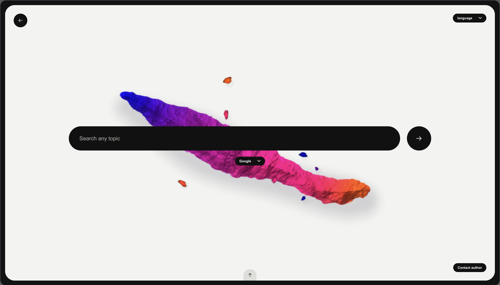
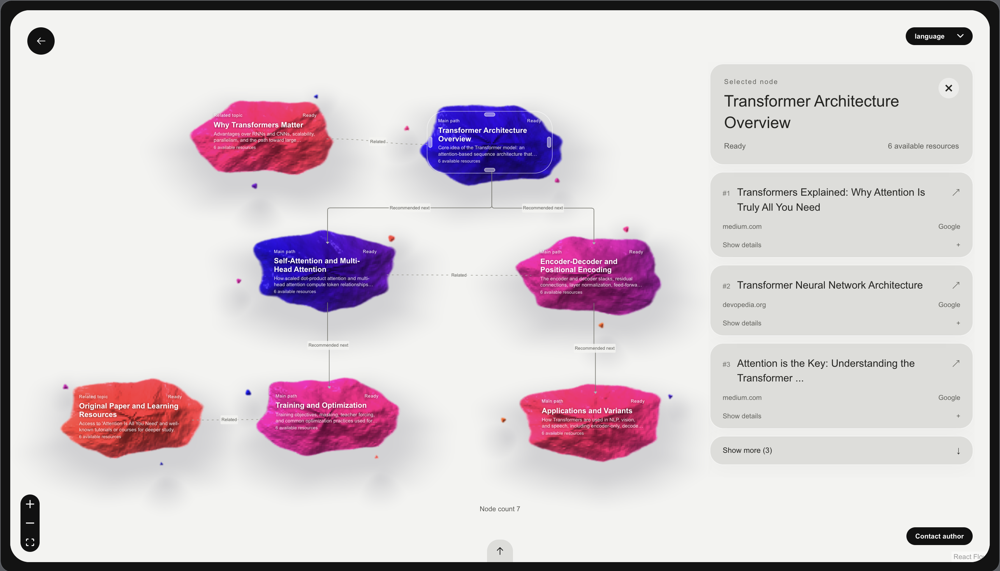

<p align="center">
  <strong>English</strong> · <a href="./README.zh-CN.md">简体中文</a>
</p>

<h1 align="center">WayFinder</h1>

<p align="center"><strong>AI-powered web search with an editable results graph</strong></p>

<p align="center">
  <a href="#technology-stack"></a>
</p>

<p align="center">
  <a href="#product-overview">Overview</a> ·
  <a href="#preview">Preview</a> ·
  <a href="#quick-start">Setup</a> ·
  <a href="#how-to-use">Guide</a> ·
  <a href="#development">Develop</a>
</p>


## Product overview

WayFinder supports research that starts with a broad question, from surveying a new field to comparing technical approaches and collecting sources for a project. **The graph is the search results page.** It connects topics and groups original web sources under the topics they address.

| Capability | What it offers |
| --- | --- |
| **Topic map** | AI organizes a question into topics. Connections distinguish suggested reading paths from related ideas, and any topic can be opened directly. |
| **Progressive results** | WayFinder searches each topic independently. The graph outline appears first, then ranked links arrive by topic with page descriptions and selection reasons. |
| **Full-graph editing** | Add, edit, or remove nodes. Organize resources, redraw connections, and adjust the layout. WayFinder saves the graph and edits in the current browser. |
| **Preview and undo** | Review new results for one node or the entire graph before applying them. Undo a specific edit while keeping later independent changes. |

> **Example query** · `How do Transformers work?`
>
> A search may branch into model architecture, self-attention, and applications. Users can open original pages from the self-attention node, add a relevant paper, and create a node for a follow-up question.

## Preview





## Quick start

Set up a local copy using [macOS Terminal](#macos-terminal) or [Windows PowerShell](#windows-powershell). Once it’s running, open `http://127.0.0.1:3000/?language=en-US`.

## How to use

### Search and browse

1. Select **Start exploring** and enter a keyword or question. Use the menu below the search box to switch between **Google** and **Baidu**. Press **Enter** to search.
2. Scroll to zoom or drag the blank canvas to pan. Select a node to see its resources on the right. Hover over a resource or use **Show details** to inspect it, then click its title to open the original page.

### Edit the whole graph

After the search finishes, edit the graph directly on the canvas.

- **Nodes and layout.** Right-click blank space and choose **Add node**. Right-click a node to edit its title or description, add a resource by URL, or delete it. Drag nodes to adjust the layout.
- **Resources.** Select a node and drag its resource cards up or down to reorder them. Right-click a resource to edit or delete it.
- **Connections.** Hover over a node to reveal its handles. Drag from one node’s bottom handle to another’s top handle for **Recommended next**, or from a right handle to a left handle for **Related**. Right-click a connection to change its type or delete it.

> [!TIP]
> **Start with a blank graph.** On the search screen, right-click the background and choose **Add node** to build a graph manually.

### Search previews

- **Single node.** Right-click a node and choose **Search this node again**. Review the preview and choose **Append to this node** or **Apply replacement**.
- **Entire graph.** Right-click blank space and choose **Search entire graph again**. For a manually created graph, enter a topic when prompted. Review the preview and choose **Apply replacement** or **Discard new results**.

> [!IMPORTANT]
> For a node search, **Apply replacement** replaces that node’s resources, including manually added links. For a full-graph search, it replaces the entire graph. **Append to this node** preserves existing resources.

### History and revisions

- **Reopen a graph.** Hover over the bottom arrow and open **Search history**. Click a graph’s title to return to the saved map and its edits. You can rename or delete saved graphs, or choose **New search graph** to start another one.
- **Undo an edit.** Open **Undo** from the same arrow and choose an available edit to reverse while keeping later independent changes. Use **Redo** to bring an edit back or **Restore search graph** to recover the most recently deleted graph.

## Development

Install Node.js `24.21.0` and run the commands from the repository root. Before starting WayFinder, fill in `LLM_API_KEY` (DeepSeek) and `SERPAPI_API_KEY` (SerpAPI) in your local `.env`. Keep `PORT=3000` so Vite can send API requests to the backend.

### macOS Terminal

1. Install the pinned pnpm version and project dependencies. Create `.env` from the template if it’s missing.

   ```bash
   npm install --global pnpm@11.25.0
   pnpm install --frozen-lockfile
   if [ ! -e .env ]; then
     cp -n .env.example .env
   fi
   ```

2. Fill in the API keys, then build and start WayFinder.

   ```bash
   pnpm build
   pnpm start
   ```

3. Keep the server running. Open a second Terminal window at the repository root and run `pnpm dev` for frontend hot reload.

### Windows PowerShell

1. Install the pinned pnpm version and project dependencies. Create `.env` from the template if it’s missing.

   ```powershell
   npm.cmd install --global pnpm@11.25.0
   pnpm.cmd install --frozen-lockfile
   if (-not (Test-Path -LiteralPath .\.env)) {
     Copy-Item -LiteralPath .\.env.example -Destination .\.env
   }
   ```

2. Fill in the API keys, then build and start WayFinder.

   ```powershell
   pnpm.cmd build
   pnpm.cmd start
   ```

3. Keep the server running. Open a second PowerShell window at the repository root and run `pnpm.cmd dev` for frontend hot reload.

Open the `Local` address printed by Vite. Append `?language=en-US` to open the English interface. After changing server code or a shared schema, rebuild and restart the backend.

### Technology stack

| Stack | Where it is used |
| --- | --- |
| React | Renders the search interface and graph editor in `apps/web`. |
| Vite | Serves the frontend during development and builds production web assets. |
| TypeScript | Provides type checking across the frontend, backend, and shared contracts. |
| Node.js | Runs the search backend in `apps/server` and streams results to the frontend. |

### Local checks

Install Playwright’s Chromium build before running the local CI checks.

**macOS Terminal**

```bash
pnpm --filter @wayfinder/web exec playwright install chromium
pnpm run ci
```

**Windows PowerShell**

```powershell
pnpm.cmd --filter '@wayfinder/web' exec playwright install chromium
pnpm.cmd run ci
```
