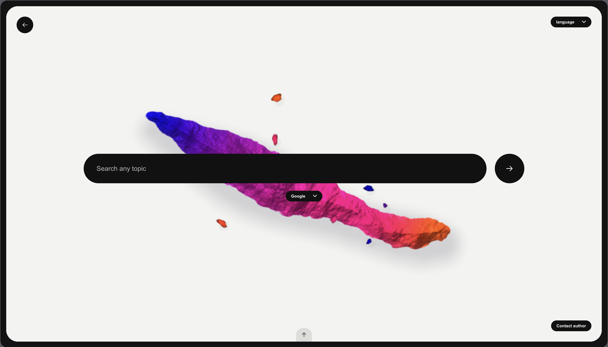
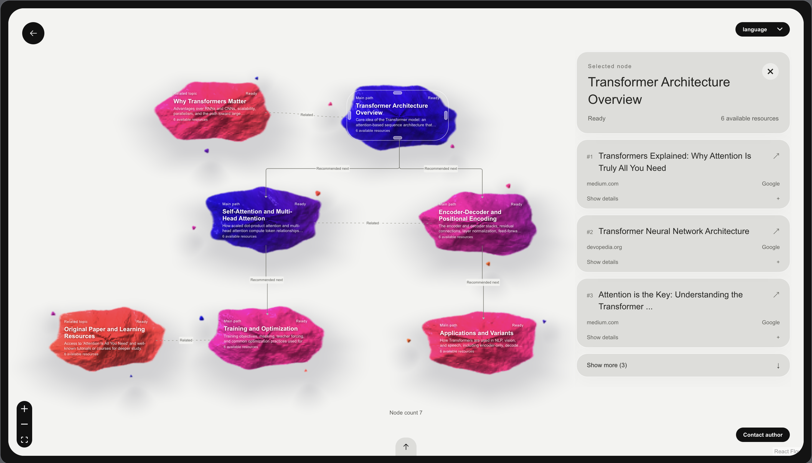

<p align="center">
  <a href="./README.md">English</a> · <strong>简体中文</strong>
</p>

<h1 align="center">WayFinder · 寻径</h1>

<p align="center"><strong>AI 网页搜索，结果以可编辑的主题图呈现</strong></p>

<p align="center">
  <a href="#技术栈"></a>
</p>

<p align="center">
  <a href="#产品介绍">产品介绍</a> ·
  <a href="#界面预览">预览</a> ·
  <a href="#快速开始">启动</a> ·
  <a href="#操作指南">操作</a> ·
  <a href="#开发指南">开发</a>
</p>


## 产品介绍

WayFinder 将网页检索组织为相互关联的主题，适合新领域入门、技术方案比较和项目资料收集。**搜索图就是结果页。** 图中呈现主题之间的关系，并为每个主题提供来自真实网页的资料。

| 能力 | 使用体验 |
| --- | --- |
| **主题组织** | AI 将问题拆分为主题节点。连线区分推荐阅读路径与相关主题，任一节点均可直接浏览。 |
| **渐进式检索** | 各主题独立检索。图的轮廓先出现，排序后的网页链接按主题陆续呈现，附网页说明与选用理由。 |
| **整图编辑** | 可新增、修改或删除节点，整理网页资源，调整连线和布局。搜索图与编辑内容保存在当前浏览器。 |
| **预览与撤销** | 单节点或全图的重搜结果可以先预览再应用。撤销某项编辑时，后续独立修改可以保留。 |

> **搜索示例** · `Transformer 是怎么工作的？`
>
> 搜索图可能包含模型架构、自注意力和应用等分支。可在自注意力节点打开原始网页，补充相关论文链接，并为延伸问题创建独立节点。

## 界面预览





## 快速开始

按 [macOS 终端](#macos) 或 [Windows PowerShell](#windows-powershell) 的步骤在本机运行。启动后，打开 `http://127.0.0.1:3000`。

## 操作指南

### 搜索与浏览

1. 点击 **开始探索**，输入关键词或问题。搜索框下方可在 **Google** 与 **百度** 之间切换。按 **Enter** 开始搜索。
2. 用滚轮缩放，拖动画布空白处平移。点选节点，在右侧查看网页资源。悬停资源条或使用 **展开详情** 查看网页说明和选用理由，点击资源标题打开原网页。

### 编辑整张图

搜索完成后，可直接在画布上编辑搜索图。

- **节点和布局。** 右键空白处，选择 **新建节点**。右键节点可修改标题和说明、通过网址添加资源，或删除节点。拖动节点可调整布局。
- **网页资源。** 选中节点后，上下拖动资源条调整顺序。右键资源可编辑或删除。
- **连线。** 悬停节点可看到连接点。从一个节点的底部连接点拖到另一个节点的顶部，建立 **推荐下一步** 关系。从右侧连接点拖到另一节点的左侧，建立 **相关** 关系。右键连线可更改关系类型或删除连线。

> [!TIP]
> **从空白建图。** 在搜索输入页右键空白处，选择 **新建节点**，即可手动建立一张搜索图。

### 重搜与预览

- **单节点。** 右键节点，选择 **重新搜索此节点**。预览后可选择 **追加到此节点** 或 **应用替换**。
- **整张图。** 右键空白处，选择 **重新搜索全图**。手动创建的图会在需要时提示填写搜索主题。预览后可选择 **应用替换** 或 **弃用新结果**。

> [!IMPORTANT]
> 单节点重搜中的 **应用替换** 会替换该节点的全部资源，包括手动添加的链接。全图重搜会在应用后替换整张图。**追加到此节点** 会保留已有资源。

### 历史与撤销

- **打开已保存的图。** 悬停底部箭头，打开 **搜索历史**。点击标题可恢复已保存的图和编辑内容。历史列表还支持重命名、删除记录和 **新建搜索图**。
- **撤销编辑。** 从底部箭头打开 **撤销**，选择一条可撤销的操作，后续独立修改会保留。可通过 **重做** 重新应用编辑，或通过 **恢复搜索图** 找回最近删除的图。

## 开发指南

安装 Node.js `24.21.0` 后，在仓库根目录运行对应平台的命令。启动前，在本地 `.env` 中填入 `LLM_API_KEY`（DeepSeek）和 `SERPAPI_API_KEY`（SerpAPI）。保留 `PORT=3000`，方便 Vite 将 API 请求转发给后端。

### macOS

1. 安装固定版本的 pnpm 和项目依赖。如果还没有 `.env`，从模板创建。

   ```bash
   npm install --global pnpm@11.25.0
   pnpm install --frozen-lockfile
   if [ ! -e .env ]; then
     cp -n .env.example .env
   fi
   ```

2. 填好 API 密钥后，构建并启动 WayFinder。

   ```bash
   pnpm build
   pnpm start
   ```

3. 保持后端运行，再开一个终端窗口，在仓库根目录执行 `pnpm dev` 启动前端热更新。

### Windows PowerShell

1. 安装固定版本的 pnpm 和项目依赖。如果还没有 `.env`，从模板创建。

   ```powershell
   npm.cmd install --global pnpm@11.25.0
   pnpm.cmd install --frozen-lockfile
   if (-not (Test-Path -LiteralPath .\.env)) {
     Copy-Item -LiteralPath .\.env.example -Destination .\.env
   }
   ```

2. 填好 API 密钥后，构建并启动 WayFinder。

   ```powershell
   pnpm.cmd build
   pnpm.cmd start
   ```

3. 保持后端运行，再开一个 PowerShell 窗口，在仓库根目录执行 `pnpm.cmd dev` 启动前端热更新。

使用热更新时，打开 Vite 输出的 `Local` 地址。改动服务端代码或共享数据契约后，重新构建并重启后端。

### 技术栈

| 技术 | 应用位置 |
| --- | --- |
| React | 渲染 `apps/web` 中的搜索界面与搜索图编辑器。 |
| Vite | 提供前端开发服务，构建生产环境使用的网页资源。 |
| TypeScript | 为前端、后端和共享数据契约提供类型检查。 |
| Node.js | 运行 `apps/server` 中的搜索服务，并向前端流式返回结果。 |

### 本地检查

安装 Playwright 对应的 Chromium 后，即可运行本地 CI 检查。

**macOS 终端**

```bash
pnpm --filter @wayfinder/web exec playwright install chromium
pnpm run ci
```

**Windows PowerShell**

```powershell
pnpm.cmd --filter '@wayfinder/web' exec playwright install chromium
pnpm.cmd run ci
```
